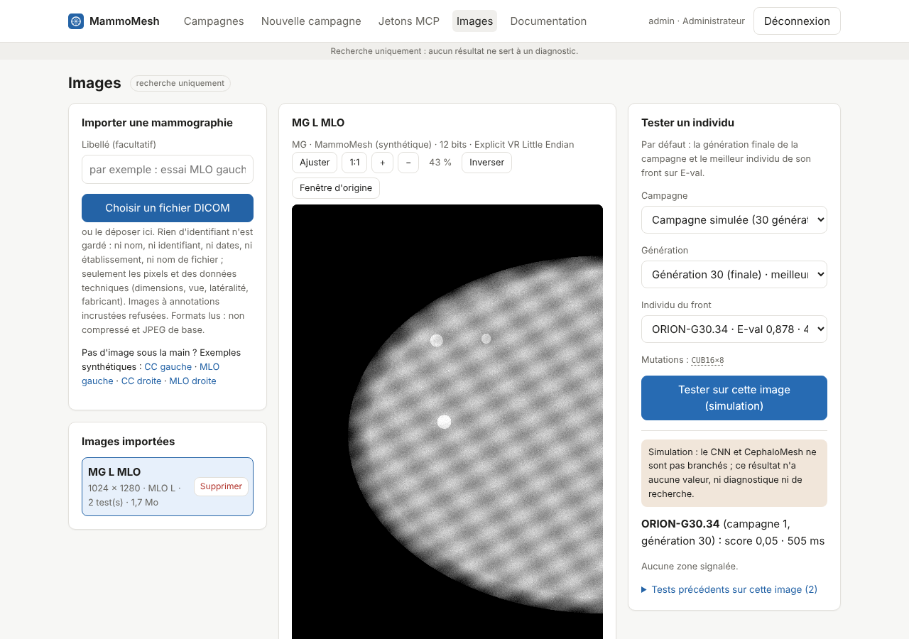

# Guide de l'écran « Images » (`/suivi/images`)

Importer une mammographie sans rien garder d'identifiant, la lire, et y tester une version du couple CNN + CephaloMesh choisie dans une campagne (génération finale par défaut).

> Version du socle : le résultat d'un test est **simulé** (déterministe, sans valeur) tant que le CNN et CephaloMesh ne sont pas branchés.

## 1. Importer une mammographie

Charger un fichier DICOM pour y tester des individus.

| Élément | Rôle |
|---|---|
| Libellé | Nom affiché dans la liste ; à défaut, modalité, latéralité et vue (« MG L CC »). Le nom du fichier n'est jamais repris : il peut contenir celui d'une patiente. |
| Choisir un fichier DICOM, ou le déposer | Le fichier est lu sur le serveur. Seuls les pixels et des données techniques sont gardés (dimensions, bits, vue, latéralité, fabricant, modèle, fenêtre d'affichage) ; nom, identifiant, dates, établissement et tous les autres en-têtes sont écartés à la lecture et jamais stockés. |
| Refus | Images à annotations incrustées (BurnedInAnnotation = YES), images en couleur, fichiers illisibles et compressions non prises en charge (JPEG 2000, JPEG-LS). Formats lus : non compressé et JPEG de base ; 300 Mo au plus. |
| Doublons | Une image aux pixels identiques à une image déjà importée n'est pas dupliquée : l'existante est sélectionnée. |
| Exemples synthétiques | Quatre mammographies générées (CC et MLO, gauche et droite), sans patiente réelle, à télécharger puis importer pour essayer l'écran. Leurs en-têtes portent de fausses données patient, qui disparaissent à l'import. |

**À savoir.** Importer et tester est ouvert à tous les rôles sauf le lecteur ; chaque import et chaque test sont inscrits au journal d'audit.

## 2. Images importées

Les images disponibles, la plus récente en tête.

| Élément | Rôle |
|---|---|
| Ligne d'image | Libellé, dimensions en pixels, vue et latéralité, nombre de tests et taille stockée. Un clic l'affiche dans la visionneuse. |
| Supprimer | Efface définitivement l'image, ses pixels et ses tests, après confirmation. Réservé à l'administrateur et au data manager. |

## 3. Visionneuse

L'image en pleine résolution (16 bits), avec les outils de lecture courants.

| Élément | Rôle |
|---|---|
| Ajuster, 1:1, +, − | Image entière dans le cadre, taille réelle (un pixel d'image par pixel d'écran), zoom avant et arrière. La molette zoome autour du pointeur ; glisser déplace l'image ; double-clic : ajuster. |
| Fenêtrage (centre, largeur) | Choisit la plage de valeurs affichée du noir au blanc : centre = niveau moyen, largeur = contraste (plus étroite, plus contrastée). Curseurs sous l'image, ou clic droit glissé (Maj + glisser) : horizontalement la largeur, verticalement le centre. |
| Inverser, Fenêtre d'origine | Inverse les niveaux de gris ; « Fenêtre d'origine » revient à la fenêtre du fichier (ou, à défaut, aux centiles 1 % et 99 %) et au sens d'origine. |
| Zones | Montre ou masque les zones du test affiché : cadre rouge numéroté avec son score ; survolée, la zone passe en jaune. |
| Clavier | La visionneuse sélectionnée répond à + et − (zoom), 0 (ajuster), i (inverser), f (fenêtre d'origine), z (zones). |

## 4. Tester un individu

Choisir une version du couple CNN + CephaloMesh et la faire travailler sur l'image affichée.

| Élément | Rôle |
|---|---|
| Campagne | Par défaut, la campagne terminée ou arrêtée la plus récente qui a des individus réalisables. |
| Génération | Par défaut la génération finale ; toute génération intermédiaire avec un front peut être choisie. Les générations sans individu réalisable ne sont pas sélectionnables. |
| Individu du front | Les individus du front de la génération, avec leur sensibilité sur E-val et leur coût ; par défaut le meilleur sur E-val. Ses mutations s'expliquent au survol. |
| Tester sur cette image (simulation) | Lance le test et affiche le résultat : score de l'image, temps de calcul, zones signalées (type et score), superposées à l'image. |
| Bandeau « Simulation » | Tant que le CNN et CephaloMesh ne sont pas branchés, le résultat est tiré de façon déterministe à partir de l'image et de l'individu : il n'a aucune valeur, ni diagnostique ni de recherche. |
| Tests précédents | Historique des tests sur cette image (individu, génération, score, date) ; un clic réaffiche un résultat. |

**À savoir.** Le même individu sur la même image donne toujours le même résultat simulé ; un individu plus sensible signale en moyenne plus de zones.

## Stockage

Les pixels (16 bits, compressés) sont rangés dans SeaweedFS (`IMAGES_URL`, réseau interne de la pile Docker) ou dans un dossier local (`IMAGES_DIR`, développement). Les métadonnées techniques et l'historique des tests sont en base. Ils ne sont pas compris dans la sauvegarde restic actuelle, qui ne couvre que PostgreSQL.
