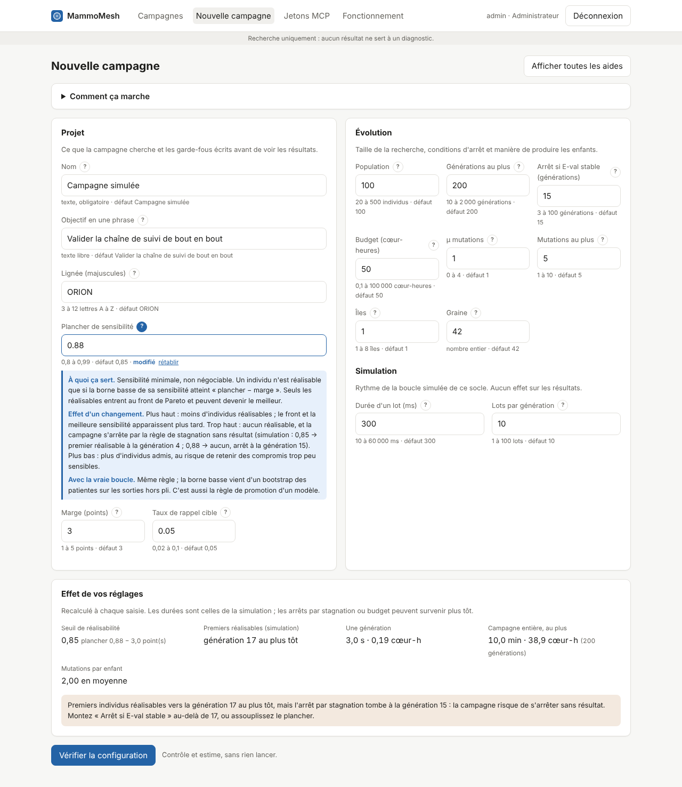

# Guide de l'écran « Nouvelle campagne » (`/suivi/nouvelle`)

Voir aussi [le fonctionnement complet d'une campagne](fonctionnement-campagne.md).

Cet écran prépare une campagne d'évolution : on règle la configuration, on la fait vérifier, puis on la lance. Une fois lancée, la configuration est figée et identifiée par son empreinte (les 8 premiers caractères s'affichent dans le suivi) : elle ne change plus jamais.

> Version du socle : la boucle CNN + CephaloMesh est **simulée**. Les exemples chiffrés de ce guide viennent de la simulation (campagne n° 1, autres réglages par défaut). Chaque réglage indique aussi, quand c'est utile, son effet prévu avec la vraie boucle.

## Qui peut faire quoi

| Rôle | Préparer et vérifier | Lancer |
|---|---|---|
| Administrateur, responsable scientifique | oui | oui |
| Data manager | oui | non |
| Radiologue référent, lecteur | non (l'écran l'indique) | non |

## Organisation de l'écran

1. **En-tête** : titre et bouton « Afficher toutes les aides », qui déplie d'un coup l'aide de chaque réglage.
2. **« Comment ça marche »** (repliable) : les trois étapes Régler, Vérifier, Lancer.
3. **Projet** : nom, objectif, lignée et les garde-fous (plancher, marge, taux de rappel).
4. **Évolution** : taille de la recherche, conditions d'arrêt, mutations, îles, graine.
5. **Simulation** : rythme de la boucle simulée, sans effet sur les résultats.
6. **Effet de vos réglages** : conséquences calculées, mises à jour à chaque saisie, avec des alertes.
7. **Vérifier la configuration**, puis **Contrôles avant lancement** et **Lancer la campagne**.

Sous chaque champ : la plage autorisée (ou la saisie attendue), la valeur par défaut et, si la valeur a changé, la mention **modifié** avec un lien **rétablir**. Le bouton **?** à droite du libellé déplie trois rubriques : *À quoi ça sert*, *Effet d'un changement* et, s'il y a lieu, *Avec la vraie boucle*.

## Déroulé

1. **Régler.** Partir des valeurs par défaut, ne changer que ce que l'objectif demande. Les champs modifiés sont surlignés.
2. **Vérifier.** « Vérifier la configuration » crée un brouillon figé, contrôle chaque réglage et estime la durée et le calcul. **Rien n'est lancé.** Toute modification ultérieure efface la vérification : il faut vérifier à nouveau.
3. **Lancer.** « Lancer la campagne » n'apparaît que si tous les contrôles passent. Un brouillon ne se lance qu'une fois. L'orchestrateur prend la campagne en moins d'une seconde et l'écran de suivi s'ouvre, en direct.

## Repartir d'une campagne finie

Depuis une campagne terminée ou arrêtée, le bouton « Repartir de cette campagne » ouvre cet écran avec :

- le titre « Repartir de « … » » et une zone **Point de départ** ;
- les réglages de la campagne d'origine comme valeurs de référence : un réglage changé est marqué « modifié », « rétablir » revient à la valeur d'origine ;
- la **génération de départ**, la finale par défaut. La liste donne pour chaque génération sa meilleure sensibilité et son nombre de réalisables ; une génération sans réalisable n'a pas de front et ne peut pas servir.

Les individus du front de Pareto de cette génération deviennent les parents de la génération 1. Le départ fait partie de la configuration figée : il entre dans l'empreinte, s'affiche dans le bandeau de suivi et dans le journal de lancement. Les contrôles ajoutent une ligne « Point de départ » : campagne finie, génération existante, front non vide. « Partir de zéro à la place » revient aux valeurs par défaut.

Depuis Claude Code : l'outil `config_brouillon` accepte `depart_campagne_id` et, si besoin, `depart_generation` (la dernière par défaut).

## Les réglages

### Projet

Ce que la campagne cherche et les garde-fous écrits avant de voir les résultats.

#### Nom

- **Saisie** : texte, obligatoire · **défaut** : Campagne simulée · clé `projet.nom`
- **À quoi ça sert.** Nom affiché dans la liste des campagnes, le bandeau de suivi, le journal et les réponses MCP. Obligatoire.
- **Effet d'un changement.** Aucun effet sur les calculs. Il entre dans l'empreinte de la configuration : deux campagnes aux réglages identiques mais aux noms différents ont deux empreintes.

#### Objectif en une phrase

- **Saisie** : texte libre · **défaut** : Valider la chaîne de suivi de bout en bout · clé `projet.objectif`
- **À quoi ça sert.** L'hypothèse ou la question, écrite avant le lancement et figée avec la configuration : on ne la réécrit pas après avoir vu les résultats.
- **Effet d'un changement.** Aucun effet sur les calculs ; change l'empreinte.

#### Lignée (majuscules)

- **Saisie** : 3 à 12 lettres A à Z · **défaut** : ORION · clé `projet.lignee`
- **À quoi ça sert.** Préfixe du nom de chaque individu : ORION-G03.02 désigne l'individu 2 de la génération 3 de la lignée ORION. De 3 à 12 lettres majuscules, sans accent.
- **Effet d'un changement.** Aucun effet sur les calculs. Une lignée par campagne évite de confondre leurs individus quand on les cite (fiche, comparaison, outils MCP par nom).

#### Plancher de sensibilité

- **Saisie** : 0,8 à 0,99 · **défaut** : 0,85 · clé `projet.plancher_sensibilite`
- **À quoi ça sert.** Sensibilité minimale, non négociable. Un individu n'est réalisable que si la borne basse de sa sensibilité atteint « plancher − marge ». Seuls les réalisables entrent au front de Pareto et peuvent devenir le meilleur.
- **Effet d'un changement.** Plus haut : moins d'individus réalisables ; le front et la meilleure sensibilité apparaissent plus tard. Trop haut : aucun réalisable, et la campagne s'arrête par la règle de stagnation sans résultat (simulation : 0,85 → premier réalisable à la génération 4 ; 0,88 → aucun, arrêt à la génération 15). Plus bas : plus d'individus admis, au risque de retenir des compromis trop peu sensibles.
- **Avec la vraie boucle.** Même règle ; la borne basse vient d'un bootstrap des patientes sur les sorties hors pli. C'est aussi la règle de promotion d'un modèle.

#### Marge (points)

- **Saisie** : 1 à 5 points · **défaut** : 3 · clé `projet.marge_points`
- **À quoi ça sert.** Marge de non-infériorité, en points de sensibilité, retranchée du plancher : seuil appliqué = plancher − marge ÷ 100 (0,85 et 3 points → 0,82). Elle absorbe l'incertitude de la mesure.
- **Effet d'un changement.** Plus petite : contrainte plus stricte, comme un plancher plus haut (simulation : 1 point → premier réalisable à la génération 15 au lieu de 4, à la limite de l'arrêt par stagnation). Plus grande : plus permissive (5 points → réalisables dès la génération 1).

#### Taux de rappel cible

- **Saisie** : 0,02 à 0,1 · **défaut** : 0,05 · clé `projet.taux_rappel_cible`
- **À quoi ça sert.** Part des examens que le programme de dépistage rappelle (0,05 = 5 %). La sensibilité est mesurée à ce taux : à faible prévalence, il fixe presque la spécificité, et les modèles se comparent à taux de rappel égal.
- **Effet d'un changement.** Il reste le même pendant toute la campagne : c'est le point de mesure, pas un résultat (le journal rappelle « mesurée au taux de rappel cible fixé à 5,0 % »). Simulation : sans effet sur les valeurs.
- **Avec la vraie boucle.** Plus haut, la sensibilité est plus facile à atteindre, au prix de plus de faux positifs. Il doit être celui du programme visé, sinon les résultats ne sont pas transposables.

### Évolution

Taille de la recherche, conditions d'arrêt et manière de produire les enfants.

#### Population

- **Saisie** : 20 à 500 individus · **défaut** : 100 · clé `evolution.population`
- **À quoi ça sert.** Nombre d'individus (configurations CephaloMesh) évalués à chaque génération.
- **Effet d'un changement.** Le coût est proportionnel : 100 individus ≈ 0,19 cœur-heure par génération, 500 ≈ 0,97. Plus grand : recherche plus large, mais le budget s'épuise plus tôt (500 avec 50 cœur-heures : arrêt par le budget à la génération 52). Plus petit : moins cher, progression plus bruitée (20 → premier réalisable à la génération 8). Le volume stocké croît aussi : une ligne par individu et par génération.
- **Avec la vraie boucle.** La durée d'une génération croît comme la population ; dans la simulation, elle ne dépend que des lots.

#### Générations au plus

- **Saisie** : 10 à 2 000 générations · **défaut** : 200 · clé `evolution.generations_max`
- **À quoi ça sert.** Plafond dur du nombre de générations. La campagne s'arrête souvent avant, par stagnation ou par le budget.
- **Effet d'un changement.** Sert aux estimations « au plus » de durée et de coût. Plus haut : laisse la place de progresser tant que E-val bouge ; ne coûte rien si un autre arrêt survient avant. Plus bas : borne la durée, au risque de couper une progression.

#### Arrêt si E-val stable (générations)

- **Saisie** : 3 à 100 générations · **défaut** : 15 · clé `evolution.arret_stagnation`
- **À quoi ça sert.** Nombre de générations sans nouveau meilleur sur E-val (gain d'au moins 0,1 point) après lequel la campagne s'arrête. Le compteur tourne aussi tant qu'aucun individu n'est réalisable. Le journal prévient 3 générations avant.
- **Effet d'un changement.** Plus petit : arrêt rapide, au risque de s'arrêter sur un palier (simulation : 5 → arrêt à la génération 9, meilleur 0,837). Plus grand : laisse le temps de franchir les paliers, pour un coût plus élevé (40 → arrêt à la génération 181, meilleur 0,923, contre 89 et 0,913 par défaut). Doit dépasser la génération où apparaissent les premiers réalisables.
- **Avec la vraie boucle.** E-val ne sert jamais à optimiser : seulement à arrêter la boucle et à choisir le front exporté.

#### Budget (cœur-heures)

- **Saisie** : 0,1 à 100 000 cœur-heures · **défaut** : 50 · clé `evolution.budget_coeur_heures`
- **À quoi ça sert.** Plafond dur de calcul. Chaque génération consomme population × 20 000 examens × 0,35 ms ; la campagne s'arrête dès que le budget est atteint.
- **Effet d'un changement.** Plus bas : arrêt plus tôt (simulation : 5 cœur-heures → arrêt à la génération 26, meilleur 0,873). Les contrôles signalent quand le budget arrêtera la campagne avant le plafond de générations. Pendant le suivi, « Budget + » l'augmente ; il ne se baisse jamais.

#### μ mutations

- **Saisie** : 0 à 4 · **défaut** : 1 · clé `evolution.mutations_mu`
- **À quoi ça sert.** Règle le nombre de mutations de chaque enfant : m = 1 + Poisson(μ), plafonné par « Mutations au plus ». Avec μ = 1, un peu moins de 2 mutations en moyenne.
- **Effet d'un changement.** Simulation : change seulement le nombre de mutations listées par individu (journal, fiche), pas les sensibilités.
- **Avec la vraie boucle.** Plus grand : exploration, par grands pas (plus de nouveautés, plus d'enfants dégradés). Plus petit : affinage autour des meilleurs.

#### Mutations au plus

- **Saisie** : 1 à 10 · **défaut** : 5 · clé `evolution.mutations_max`
- **À quoi ça sert.** Plafond du nombre de mutations par enfant. À 1, seules des mutations uniques (affinage).
- **Effet d'un changement.** Simulation : borne le nombre de mutations listées, sans effet sur les sensibilités.
- **Avec la vraie boucle.** Plus haut : autorise les macro-mutations qui sortent d'un palier. Plus bas : recherche plus prudente.

#### Îles

- **Saisie** : 1 à 8 îles · **défaut** : 1 · clé `evolution.iles`
- **À quoi ça sert.** Nombre de populations qui évoluent en parallèle avec des réglages différents ; les meilleurs individus migrent d'une île à l'autre, ce qui limite la convergence prématurée.
- **Effet d'un changement.** Simulation : sans effet.
- **Avec la vraie boucle.** Plus d'îles : plus de diversité, au prix d'une coordination entre populations. 1 : une seule population.

#### Graine

- **Saisie** : nombre entier · **défaut** : 42 · clé `evolution.graine`
- **À quoi ça sert.** Point de départ du tirage aléatoire. Avec le numéro de campagne et de génération, elle fixe tout le tirage : une génération recalculée (reprise après panne ou pause) donne exactement le même résultat.
- **Effet d'un changement.** Une autre graine donne un autre tirage pour les mêmes réglages (simulation : 42 → arrêt à la génération 89, meilleur 0,913 ; 7 → génération 100, 0,915). Utile pour vérifier qu'un écart entre deux réglages n'est pas dû au hasard. Deux campagnes de même graine diffèrent quand même : le numéro de campagne entre dans le tirage.

### Simulation

Rythme de la boucle simulée de ce socle. Aucun effet sur les résultats.

#### Durée d'un lot (ms)

- **Saisie** : 10 à 60 000 ms · **défaut** : 300 · clé `simulation.duree_lot_ms`
- **À quoi ça sert.** Temps simulé d'évaluation d'un lot d'individus, en attendant le vrai moteur. Le suivi reçoit une progression à chaque lot.
- **Effet d'un changement.** Aucun effet sur les résultats, seulement sur le rythme : une génération dure « durée d'un lot × lots par génération » (300 ms × 10 = 3 s). À baisser pour une démonstration rapide, à monter pour observer le suivi en direct.

#### Lots par génération

- **Saisie** : 1 à 100 lots · **défaut** : 10 · clé `simulation.lots_par_generation`
- **À quoi ça sert.** Nombre d'étapes de progression d'une génération (« lot 3 sur 10 » dans le bandeau de suivi).
- **Effet d'un changement.** Aucun effet sur les résultats. Plus de lots : progression plus fine et plus de messages ; la consommation du budget est répartie par lot.

## Effet de vos réglages

Le panneau recalcule, à chaque saisie, avec les mêmes formules que le serveur :

| Ligne | Calcul | Défaut |
|---|---|---|
| Seuil de réalisabilité | plancher − marge ÷ 100 | 0,82 |
| Premiers réalisables (simulation) | génération où le plafond simulé permet d'atteindre le seuil, au plus tôt | génération 3 (4 en pratique) |
| Une génération | durée d'un lot × lots par génération ; population × 20 000 × 0,35 ms en cœur-heures | 3 s · 0,19 cœur-h |
| Campagne entière, au plus | une génération × générations au plus | 10 min · 38,9 cœur-h |
| Mutations par enfant | moyenne de min(1 + Poisson(μ), mutations au plus) | 2,00 |

Alertes affichées :

- **Seuil hors d'atteinte** : aucun individu ne sera réalisable dans la simulation ; la campagne s'arrêtera par stagnation sans résultat.
- **Stagnation trop courte** : les premiers réalisables arrivent après l'arrêt par stagnation. Monter « Arrêt si E-val stable » ou assouplir le plancher (ou la marge).
- **Budget limitant** : le budget arrêtera la campagne avant le plafond de générations, après la génération indiquée.

## Contrôles avant lancement

Le tableau reprend chaque réglage avec son libellé, ✓ ou ✗, et la valeur comparée à sa plage. Un seul ✗ bloque le lancement. Une ligne « Budget et plafond » apparaît quand le budget arrêtera la campagne avant le plafond de générations : c'est une information, pas un blocage.

Sous le tableau : la durée et le calcul estimés **au plus** (la stagnation ou le budget peuvent arrêter avant) et la liste des réglages modifiés par rapport aux valeurs par défaut.

## Interactions à connaître

| Si vous… | Alors… |
|---|---|
| montez le plancher ou baissez la marge | moins d'individus réalisables : vérifiez l'alerte « stagnation trop courte » |
| montez la population | coût par génération plus élevé : le budget peut devenir limitant |
| baissez l'arrêt par stagnation | campagne plus courte, mais risque d'arrêt sur un palier ou avant tout réalisable |
| baissez le budget | arrêt plus tôt ; « Budget + » dans le suivi permet de l'augmenter en cours de route |
| changez la graine | autre tirage, mêmes réglages : pour vérifier qu'un écart n'est pas dû au hasard |
| changez durée de lot ou nombre de lots | seul le rythme change, jamais les résultats |

## Recettes

- **Démonstration rapide** : durée d'un lot 50 ms, 4 lots, 30 générations. Environ 6 s de calcul simulé.
- **Campagne exigeante** (plancher 0,90) : la simulation n'a pas de réalisable avant la génération 30 environ. Monter « Arrêt si E-val stable » à 40 (premier réalisable vers la génération 38, arrêt vers la 181).
- **Comparer deux réglages** : lancer chaque réglage avec deux graines différentes ; ne retenir un écart que s'il tient sur les deux.

## Si rien ne se passe

- **Pas de bouton « Lancer »** : un contrôle est en échec (✗), ou votre rôle ne permet pas de lancer (un message le dit).
- **Le tableau des contrôles disparaît** : un réglage a été modifié après la vérification ; vérifier à nouveau.
- **La campagne reste à la génération 0** : l'orchestrateur ne tourne pas. `docker compose ps` doit le montrer actif ; ses journaux (`docker compose logs orchestrator`) doivent contenir « orchestrateur actif ».
