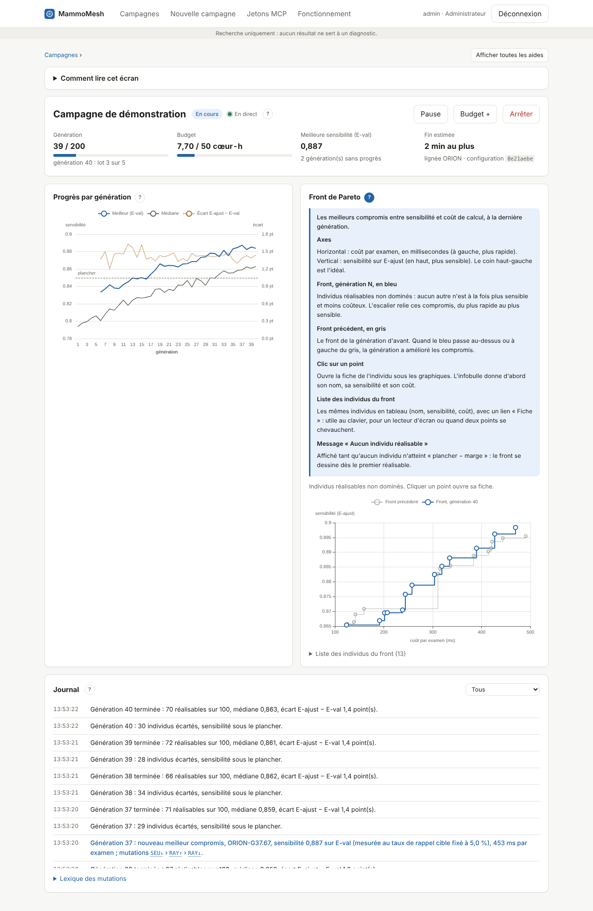

# Guide de l'écran de suivi d'une campagne (`/suivi/campagnes/<numéro>`)

Cet écran suit une campagne en direct : l'orchestrateur calcule, l'écran se met à jour seul, sans recharger. Il s'ouvre après le lancement, ou depuis la liste « Campagnes ». Fermer l'onglet n'interrompt rien.

> Version du socle : la boucle CNN + CephaloMesh est **simulée**. Les valeurs (sensibilités, coûts, génomes) ont la forme de la vraie boucle, pas sa signification.

## Organisation de l'écran

1. **Fil d'Ariane** et bouton **« Afficher toutes les aides »**, qui déplie l'aide de chaque zone.
2. **« Comment lire cet écran »** (repliable) : l'ordre de lecture en quatre points.
3. **Bandeau de la campagne** : état, commandes, chiffres clés.
4. **Progrès par génération** et **Front de Pareto**, côte à côte (l'un sous l'autre sur téléphone).
5. **Fiche d'un individu**, quand on clique un point du front.
6. **Journal**.

Chaque zone a un bouton **?** à côté de son titre : il déplie la description de la zone et de ses éléments. Le fonctionnement complet d'une campagne et le lexique des mutations sont dans [fonctionnement-campagne.md](fonctionnement-campagne.md) (menu « Fonctionnement » de l'application).

## Vocabulaire

| Terme | Sens |
|---|---|
| Génération | Une population entière évaluée, puis les meilleurs retenus comme parents de la suivante |
| Individu réalisable | Individu dont la borne basse de sensibilité atteint « plancher − marge » ; seuls ceux-là comptent |
| E-ajust | Partie du jeu d'évolution sur laquelle l'évolution optimise (75 % des patientes) |
| E-val | Partie de contrôle (25 %), jamais utilisée pour optimiser : elle arrête la campagne et choisit le front exporté |
| Front de Pareto | Ensemble des compromis sensibilité / coût qu'aucun autre individu ne bat sur les deux à la fois |
| Cœur-heure | Une heure de calcul sur un cœur de processeur ; unité du budget |

## 1. Bandeau de la campagne

L'état de la campagne en un coup d'œil, et les commandes pour la piloter.

| Élément | Rôle |
|---|---|
| Nom et badge d'état | En cours, En pause, Terminée (plafond, budget ou stagnation atteint), Arrêtée (par une personne) ou En échec (erreur de l'orchestrateur, voir le journal). |
| En direct / Reconnexion… | Pastille verte : le flux temps réel est ouvert, l'écran se met à jour seul. Orange : connexion perdue ; le navigateur se reconnecte et reprend là où il s'était arrêté, sans rien perdre ni recharger. |
| Pause, Reprendre | Pause suspend la campagne après le lot en cours ; la génération interrompue sera refaite à l'identique à la reprise (même graine, même tirage). |
| Budget + | Augmente le budget de calcul, en cœur-heures, par exemple quand la campagne approche de son plafond alors qu'elle progresse encore. Le budget ne se baisse jamais. |
| Repartir de cette campagne | Sur une campagne terminée ou arrêtée : ouvre « Nouvelle campagne » avec ses réglages, à modifier, et le front de sa génération finale comme parents. Une génération intermédiaire peut être choisie à la place. |
| Arrêter | Arrêt définitif, après confirmation. Les résultats déjà calculés restent consultables ; la campagne ne peut plus reprendre. |
| Génération | Générations terminées sur le plafond, avec une barre. Pendant le calcul, la ligne « génération N : lot a sur b » suit la génération en cours, lot par lot. |
| Budget | Cœur-heures consommées sur le budget, mis à jour à chaque lot. Quand la barre est pleine, la campagne s'arrête à la fin de la génération en cours. |
| Meilleure sensibilité (E-val) | Meilleure sensibilité mesurée sur E-val parmi les individus réalisables depuis le début ; « — » tant qu'aucun ne l'est. Dessous, le nombre de générations sans progrès d'au moins 0,1 point : la campagne s'arrête quand il atteint le réglage « Arrêt si E-val stable ». |
| Fin estimée | Durée moyenne des 10 dernières générations × générations restantes, « au plus » car la stagnation ou le budget peuvent arrêter avant. « — » hors calcul. |
| Lignée et configuration | Préfixe des noms d'individus et 8 premiers caractères de l'empreinte de la configuration figée : deux campagnes à la même empreinte ont exactement les mêmes réglages. |
| Départ | Pour une campagne qui repart d'une autre : lien vers la campagne d'origine et génération dont le front a fourni les parents. |

**À savoir.** Les commandes n'apparaissent qu'au responsable scientifique et à l'administrateur ; chaque geste est inscrit au journal d'audit. L'interface peut être fermée : l'orchestrateur continue seul.

## 2. Progrès par génération

Comment la recherche avance, génération après génération.

| Élément | Rôle |
|---|---|
| Meilleur (E-val), trait bleu | Sensibilité sur E-val du meilleur individu réalisable de chaque génération. Un trou signifie qu'aucun individu n'était réalisable (l'infobulle indique « aucun réalisable »). |
| Médiane, trait gris | Sensibilité médiane (E-ajust) de toute la population, réalisables ou non : elle montre si l'ensemble progresse, pas seulement le meilleur. |
| Écart E-ajust − E-val, pointillé orange, axe de droite | Écart moyen, en points, entre la sensibilité sur laquelle l'évolution optimise (E-ajust) et celle mesurée à part (E-val), pour les réalisables. C'est l'optimisme de la sélection : s'il grandit, l'évolution s'ajuste à E-ajust plus qu'elle ne progresse vraiment. |
| Ligne « plancher », tirets | Le plancher de sensibilité de la configuration. La règle de réalisabilité tolère la marge (seuil = plancher − marge) : un meilleur sous la ligne reste admis. |
| Infobulle | Survoler une génération affiche ses trois valeurs. |

**À savoir.** E-val ne sert jamais à optimiser : seulement à arrêter la campagne et à choisir le front exporté. Une courbe bleue plate depuis longtemps annonce l'arrêt par stagnation.

## 3. Front de Pareto

Les meilleurs compromis entre sensibilité et coût de calcul, à la dernière génération.

| Élément | Rôle |
|---|---|
| Axes | Horizontal : coût par examen, en millisecondes (à gauche, plus rapide). Vertical : sensibilité sur E-ajust (en haut, plus sensible). Le coin haut-gauche est l'idéal. |
| Front, génération N, en bleu | Individus réalisables non dominés : aucun autre n'est à la fois plus sensible et moins coûteux. L'escalier relie ces compromis, du plus rapide au plus sensible. |
| Front précédent, en gris | Le front de la génération d'avant. Quand le bleu passe au-dessus ou à gauche du gris, la génération a amélioré les compromis. |
| Clic sur un point | Ouvre la fiche de l'individu sous les graphiques. L'infobulle donne d'abord son nom, sa sensibilité et son coût. |
| Liste des individus du front | Les mêmes individus en tableau (nom, sensibilité, coût), avec un lien « Fiche » : utile au clavier, pour un lecteur d'écran ou quand deux points se chevauchent. |
| Message « Aucun individu réalisable » | Affiché tant qu'aucun individu n'atteint « plancher − marge » : le front se dessine dès le premier réalisable. |

## 4. Fiche d'un individu

Tout ce qu'on sait d'un individu choisi sur le front.

| Élément | Rôle |
|---|---|
| Sensibilité (E-ajust) [basse ; haute] | Sensibilité sur laquelle l'évolution optimise, avec son intervalle. La borne basse décide de la réalisabilité. |
| Sensibilité (E-val) | Même mesure sur la partie de contrôle, jamais utilisée pour optimiser. |
| Coût par examen | Temps de calcul de CephaloMesh pour un examen, en millisecondes. |
| Mutations | Mutations qui ont produit cet individu, séparées par ›. Chaque code est expliqué en clair juste dessous (gène modifié, partie CephaloMesh ou CNN, effet attendu) ; survoler un code ou le sélectionner au clavier affiche aussi son explication. Le lexique complet est en bas de la fiche. |
| Parent | Individu du front précédent dont il descend ; « fondateur » à la première génération. |
| Gènes | Valeurs du génome CephaloMesh : seuil, tau, lambda, budget d'activité, rayon des stimuli (mm), tours (1 ou 2 retours au CNN) et contrôles actifs. |
| Fermer | Referme la fiche ; un autre clic sur le front en ouvre une autre. |

**À savoir.** Dans ce socle, génomes et mesures sont simulés : leur forme est celle de la vraie boucle, pas leurs valeurs.

## 5. Journal

Ce qui s'est passé, en phrases, le plus récent en tête.

| Élément | Rôle |
|---|---|
| Lignes | Heure et message de chaque événement, sans regroupement : lancement, génération terminée, nouveau meilleur, individus écartés, stagnation, changement d'état, hausse de budget, reprise après redémarrage, fin ou échec. |
| Taux de rappel dans « nouveau meilleur » | Toujours la même valeur pendant une campagne : c'est le taux de rappel cible de la configuration, auquel la sensibilité est mesurée, pas un résultat. Les modèles se comparent à taux de rappel égal. |
| Filtre | Restreint la liste à un type : nouveaux meilleurs, générations, individus écartés, stagnation, changements d'état. « Tous » rétablit tout. |
| Codes de mutations | Dans les lignes « nouveau meilleur », chaque code de mutation s'explique au survol ou au clavier ; le « Lexique des mutations » en bas du journal les décrit tous. |
| Mises à jour | Les nouveaux événements s'insèrent en tête en direct ; les 200 plus récents sont affichés. |

**À savoir.** Le journal est aussi lisible par Claude Code (outil MCP journal_lire), avec les mêmes messages.

## États d'une campagne

| Badge | Signification | Commandes possibles |
|---|---|---|
| En cours | L'orchestrateur calcule | Pause, Budget +, Arrêter |
| En pause | Suspendue ; la génération interrompue sera refaite à l'identique | Reprendre, Budget +, Arrêter |
| Terminée | Plafond de générations, budget ou stagnation de E-val atteint (le journal dit lequel) | Repartir de cette campagne |
| Arrêtée | Arrêt demandé par une personne | Repartir de cette campagne |
| En échec | Erreur de l'orchestrateur, détaillée dans le journal | aucune |

## Situations courantes

| Ce que vous voyez | Ce que ça veut dire | Que faire |
|---|---|---|
| Génération 0, lot qui avance | La première génération est en calcul | Attendre la fin du premier lot de générations |
| « Meilleure sensibilité » à « — » et front vide | Aucun individu réalisable encore | Normal en début de campagne ; si ça dure jusqu'à l'alerte de stagnation, le plancher est trop exigeant |
| Message « E-val stable depuis N générations » | L'arrêt par stagnation approche (3 générations d'avance) | Laisser finir, ou relancer avec un arrêt de stagnation plus long |
| Barre de budget presque pleine alors que ça progresse | Le budget va arrêter la campagne | « Budget + » |
| Pastille orange « Reconnexion… » | Lien temps réel coupé (réseau, serveur redémarré) | Rien : la reconnexion reprend sans perte |
| Écart E-ajust − E-val qui grimpe | La sélection s'ajuste à E-ajust | Se fier à la courbe E-val ; envisager un arrêt plus précoce |
